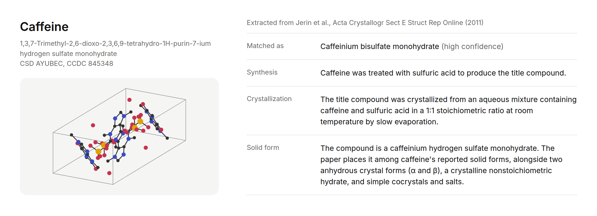
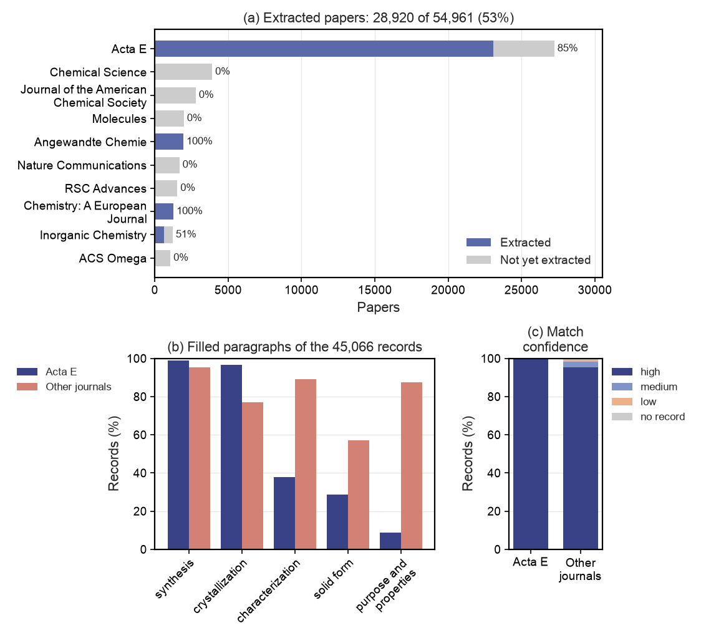

<div align="center">

# TEXtal

**A dataset of crystal structures paired with text-mined crystallization procedures and outcomes.**

[](https://huggingface.co/datasets/alstonlo/textal-data)



</div>

TEXtal links entries in the Cambridge Structural Database (CSD) to the crystallization
procedures and outcomes reported in their papers. We download the open-access papers of the CSD
from PubMed Central (PMC), convert them to Markdown and use a large language model (LLM) to
extract the synthesis and crystallization procedure of each entry, with quotes from the paper
as evidence. The pairs support text-conditioned crystal structure prediction (CSP), which
predicts the crystal that a molecule forms under a written procedure, and condition generation,
which predicts a procedure that yields a given crystal.

> [!WARNING]
> This project was created for the Open Scientific Intelligence Hackathon 2026. It is still a
> prototype, and there are papers we were not able to mine: the records cover 28,920 of the
> 54,961 papers (53%).

## Installation

We use the [pixi](https://pixi.sh) dependency manager (Linux only). MinerU, the optical
character recognition (OCR) tool for scanned PDFs, needs a GPU and its own environment
(`pixi install -e ocr`).

```bash
git clone https://github.com/alstonlo/textal.git
cd textal
pixi install
```

## Usage

**CSD metadata.** The pipeline starts from `data/raw/csd_metadata.full.parquet`, the metadata of
every CSD entry (refcode, compound name, journal and DOI). Exporting it needs a licence from the
Cambridge Crystallographic Data Centre (CCDC), so it is not in this repository. Install the CSD
data from the [CCDC downloads page](https://www.ccdc.cam.ac.uk/support-and-resources/csdsdownloads/),
install the CSD Python API in its own environment (`pixi install -e csd`) and write your
licence code to a file named `.env` at the repository root:

```bash
CCDC_LICENSING_CONFIGURATION=la-code;<your-licence-code>
CSD_DATA_DIRECTORY=<folder of the CSD data>
```

The second line is needed only if the CCDC installer did not record the location of the CSD data
in `~/.config/CCDC/CSD.ini`. Then export the metadata:

```bash
pixi run -e csd python scripts/runs/csd/s0_metadata.py
```

**Corpus.** This command looks up the DOI of every CSD entry in PMC's list, downloads the papers
that are there from PMC's open-access bucket (several hours and about 200 GB; an interrupted
download resumes) and converts them to Markdown. The papers of Acta Crystallographica Section E
(Acta E), the journal with the most CSD entries, were also fetched as complete PMC packages,
which hold the original crystallographic information files (CIFs) and chemical schemes that the
website shows.

```bash
pixi run snakemake -s scripts/Snakefile -j1 all
```

**Extraction.** The model is called through a LiteLLM proxy and needs an API key. A run writes
`data/runs/<name>/extractions.parquet`, one record per CSD entry, and resumes if stopped.

```bash
export LITELLM_API_KEY=...
pixi run python -m dataset.extraction_stream --sample 200 --run data/runs/pilot200   # a sample
pixi run python -m dataset.extraction_stream --run data/runs/corpus                  # every paper
```

This runner reads the full Markdown of a paper. We read the Acta E papers with a second runner
that reads only the experimental sections and has the model pick its quotes from numbered
passages, so that the quotes are verbatim by construction. The records of both runs are gathered
in `data/extractions.parquet`, kept to the papers of the corpus; its `prompt_version` column
tells the runs apart.

```bash
pixi run snakemake -s scripts/Snakefile -j1 plot_extraction   # Figure 1
pixi run snakemake -s scripts/Snakefile -j1 example           # the example above (needs Chrome)
```

**Data.** The dataset is on Hugging Face at
[alstonlo/textal-data](https://huggingface.co/datasets/alstonlo/textal-data): `entries.parquet`
(one row per CSD refcode with its extracted record), `papers.parquet` (one row per paper: its
bibliography, licence and the quoted snippets) and `files/<NN>/<PMCID>.tar.gz` (the CIFs and
chemical schemes the publisher supplied with each paper, `NN` being the last two digits of the
PMCID). The tables hold nothing from the CSD but refcodes and DOIs. Download it (about 3 GB)
into `data/textal/`:

```bash
pixi run hf download alstonlo/textal-data --repo-type dataset --local-dir data/textal
```

**Website.** For each extracted entry, the website shows the crystal structures of its paper
(drawn from the publisher's CIFs), its chemical scheme and the record, with the quote behind each
paragraph; it shows the text of the CC BY papers only. It runs on the downloaded dataset:

```bash
pixi run web --port 8000
```

The tables are built from the corpus with `pixi run snakemake -s scripts/Snakefile -j1 tables`
and the paper packages with `scripts/runs/viz/s3_release.py`.

## About TEXtal

Crystal structure prediction (CSP) predicts how a molecule packs into a crystal from the molecule
alone, yet the same molecule can form polymorphs (different molecular arrangements), solvates
(crystals containing solvent) or salts (ionic compounds), depending on the procedure. The procedure
is the missing input, recorded nowhere but in the papers: the Cambridge Structural Database (CSD)
does not store it, and we found no public dataset pairing CSD structures with their crystallization
procedures.

Mining these procedures is limited by access rather than by method. Of the 554,956 papers the CSD
cites, the 56,225 in PubMed Central's (PMC) open-access list can be downloaded and read; the rest
sit behind publisher sites. These accessible papers cover 121,147 entries, including about one
in five new entries since 2020. TEXtal extracts procedures from this subset. For scale, the
text-mined inorganic synthesis dataset of
[Kononova et al. (2019)](https://doi.org/10.1038/s41597-019-0224-1), which became a standard
training set, holds 19,488 recipes; TEXtal already holds 39,082 entries with a crystallization
paragraph.

**Approach.** We download papers automatically from PMC's open-access bucket on Amazon Web
Services, which held 54,961 of the 56,225 papers (203 GB), each with full text as XML. We convert
XML to Markdown with pandoc without optical character recognition (OCR), and supplementary PDFs
with PyMuPDF4LLM; the 1.6% that are scanned still need OCR with MinerU.

We send one large language model (LLM) request per paper, with its text and a table of its CSD
entries: refcode (entry identifier), Cambridge Crystallographic Data Centre (CCDC) deposition
number, name and formula. For each entry, we ask the model to name the compound, rate its match
confidence (high, medium or low) and write one short paragraph per topic: synthesis (compound
preparation), crystallization (crystal growth), characterization (analytical measurements), solid
form (crystal composition and arrangement, such as a salt or hydrate) and purpose and properties,
each backed by at least one verbatim quote. We ask for paragraphs rather than fixed fields (solvent, method,
temperature) because we do not know what the papers report; fields can be derived later.

Papers from other journals were read in full by `gpt-6-luna`; Acta Crystallographica Section E
(Acta E) papers, which report one structure each in a fixed layout, were read by `gpt-5.6-luna`
from their experimental sections only. Both ran at reasoning effort `high`, which gave the same
matches and core paragraphs as `max` about 10 times faster.

**Results.** The extraction covers **45,066 CSD entries from 28,920 papers**, 53% of the corpus's
papers (Figure 1a): 23,420 entries from 23,077 Acta E papers (85% of Acta E) and 21,646 entries
from 5,843 papers in other journals (21% of papers in those journals). The model wrote records
for 44,826 entries (99.5%) and rated 98% of its matches high confidence.

Most records describe synthesis and crystallization: 97% describe synthesis, 87% crystallization,
62% characterization, 46% purpose and properties and 42% solid form (Figure 1b). The Acta E run,
reading experimental sections only, nearly always includes synthesis and crystallization and
rarely the other topics.

In a manual check of 10 papers, the model matched all 23 entries to the right compound; of its
337 quotes, 27 differed from the paper, mostly in hyphenation or letter case.

Of the papers, 74% are under Creative Commons Attribution (CC BY), so their text can be shared.

<div align="center"><figure>

</figure></div>

> **Figure 1.** (a) Paper counts for the ten largest journals, split into papers that were mined
(blue) and papers that were not (grey), with the share mined. Papers were mined journal by
journal, so Inorganic Chemistry is only partly covered. (b) The share of records with each topic
paragraph filled, per run. The Acta E run read only the experimental sections, so its records
rarely cover characterization, purpose or the solid form.
(c) The confidence of the match between the CSD entry and the compound in the paper.

**Limitations.** The 26,041 papers that are not mined are mostly from general chemistry
journals, and 4,149 of them are Acta E papers. The quotes of the full-text run are not checked
against the source text automatically, unlike those of the Acta E run. The records are
paragraphs, not fixed fields (method, solvents, temperature, time). The scanned supplementary
PDFs were not read, as they need OCR.

## Licence

The CSD metadata is licensed by the CCDC and is not redistributed here, nor are tables built from
it (the website's tables hold only refcodes and DOIs). Each paper
keeps the licence given in its PMC record, and the Acta E files (CIFs and chemical schemes) the
[terms of use](https://journals.iucr.org/services/termsofuse.html) of the IUCr; the website shows
the text of the CC BY papers only.
