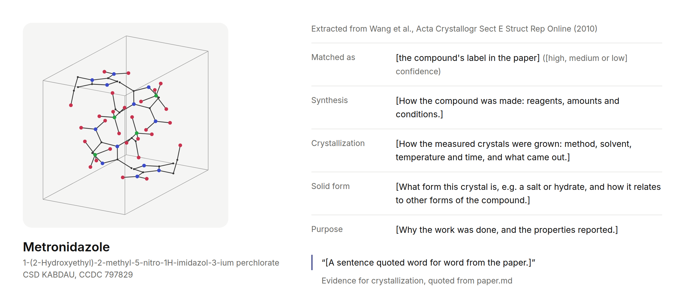
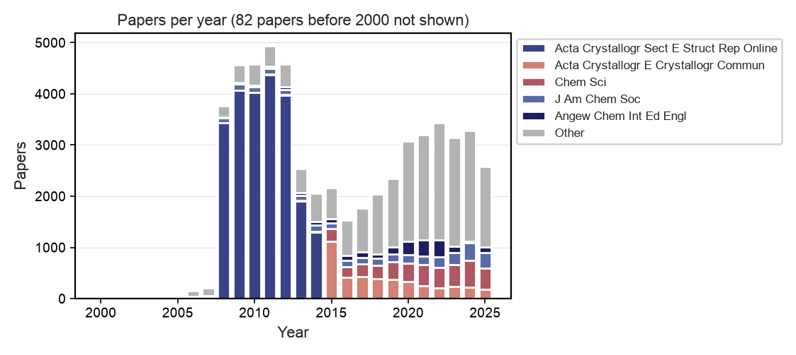

<div align="center">

# TEXtal

**A dataset of crystal structures paired with text-mined crystallization procedures and outcomes.**



</div>

TEXtal links entries in the Cambridge Structural Database (CSD) to the crystallization
procedures and outcomes reported in their papers. We download these open-access papers from
PubMed Central (PMC), convert them to Markdown, and use a large language model (LLM) to describe
how each entry's compound was made and its crystals were grown. Each record includes quotes
from the paper as evidence. The pairs support two tasks: text-conditioned crystal structure
prediction (CSP), which predicts the crystal that a molecule forms under a written procedure, and
condition generation, which predicts a procedure that yields a given crystal.

---

## Installation

We use the [pixi](https://pixi.sh) dependency manager (Linux only).

```bash
git clone https://github.com/alstonlo/clari-data-osi-hack.git
cd clari-data-osi-hack
pixi install
```

MinerU, the optical character recognition (OCR) tool for scanned PDFs, requires a GPU.
Install it in its own environment:

```bash
pixi install -e ocr
```

## Usage

### CSD Download

The pipeline starts from `data/raw/csd_metadata.full.parquet`, which holds the metadata of every
CSD entry, such as its refcode (entry identifier), compound name, journal and digital object
identifier (DOI). Exporting this metadata requires a licence from the Cambridge Crystallographic
Data Centre (CCDC), so it is not in this repository.

To export it, first download and install the CSD data from the [CCDC downloads
page](https://www.ccdc.cam.ac.uk/support-and-resources/csdsdownloads/). Then install the CSD
Python API, which has its own environment because it pins older versions of NumPy, pandas and
SciPy:

```bash
pixi install -e csd
```

Next, write your CCDC licence code to a file named `.env` at the repository root. The second line
is needed only if the CCDC installer did not record the location of the CSD data in
`~/.config/CCDC/CSD.ini`:

```bash
CCDC_LICENSING_CONFIGURATION=la-code;<your-licence-code>
CSD_DATA_DIRECTORY=<folder of the CSD data>
```

Finally, export the metadata:

```bash
pixi run -e csd python scripts/runs/csd/s0_metadata.py
```

### Build the corpus

This command downloads the papers from PMC, converts them to Markdown and plots the figures of
this README. The download takes several hours and about 200 GB of disk space. Rerunning an
interrupted download resumes it.

```bash
pixi run snakemake -s scripts/Snakefile -j1 all
```

### Extract the procedures

The extraction calls the model through a LiteLLM proxy and requires an API key. It writes
`data/runs/<name>/extractions.parquet`, with one record per CSD entry. Rerunning a stopped run
resumes it.

```bash
export LITELLM_API_KEY=...
pixi run python -m dataset.extraction_stream --sample 200 --run data/runs/pilot200   # a sample
pixi run python -m dataset.extraction_stream --run data/runs/corpus                  # every paper
```

### Website

The website shows corpus statistics and the 293 entries of the CSD Drug Subset that are reported
in open-access papers of Acta Crystallographica Section E. Each entry's page shows a 3D view of
its unit cell (the repeating unit of a crystal), its molecule, its CSD metadata, its paper and its
extracted record. To serve it at http://localhost:8000:

```bash
pixi run web --port 8000
```

The website reads only the tables in `src/viz/assets/`. Of these, only `stats.json` is in this
repository, because the other tables hold CSD data. Building them requires the CSD metadata, the
downloaded papers and the extracted records:

```bash
pixi run snakemake -s scripts/Snakefile -j1 assets
```

## About TEXtal

The Cambridge Structural Database (CSD) holds 1.4 million crystal structures, but does not
systematically record how the crystals were grown. Those procedures are described in the papers.
We built TEXtal, an open pipeline that downloads the 54,961 open-access CSD papers from
PubMed Central (PMC), converts them to Markdown,
and uses a large language model (LLM) to write a record for each CSD entry: how the compound was
made and how its crystals were grown, backed by quotes from the paper. These records can train
models for text-conditioned crystal structure prediction (CSP) and for condition generation.
In a pilot of 200 random
papers, it returned a record for all 437 CSD entries in under 3 minutes. In a separate pilot of
10 papers, our manual check found that all 23 CSD entries were matched to the right compound.

### Why

CSP models such as [Clari](https://github.com/the-matter-lab/clari) predict how a molecule packs
into a crystal from the molecule alone. But the same molecule can form different crystals
(polymorphs, solvates or salts) depending on how it is crystallized, and these models cannot
take the crystallization procedure as input. They also cannot say which solvent, method and
temperature produce a given crystal. Both tasks need crystallization procedures linked to crystal
structures. In text-conditioned CSP, a model predicts the crystal from the molecule and a
written procedure; in condition generation, a model predicts the procedure from the target
crystal. The CSD has a
`solvent` field, but it holds a single string with no method, temperature or time, and it is empty
for 84% of entries. We found no public dataset that links small-molecule crystallization
procedures to CSD entries.

### Approach

1. **Find the papers.** The CSD entries cite 554,956 unique DOIs. Of these, 56,225 are in PMC's
   DOI list, covering 121,147 CSD entries. Most publisher sites block automated downloads,
   but PMC's open-access storage bucket on Amazon Web Services (AWS) allows them.
2. **Download.** The bucket contained 54,961 papers (203 GB). Every paper has its full text as
   XML; 89% also have a PDF and 35% have supplementary documents. We check every file
   against PMC's checksum.
3. **Convert to Markdown.** Because the main text comes as XML, it needs no optical character
   recognition (OCR); we convert it with pandoc. We convert supplementary PDFs with PyMuPDF4LLM,
   which reads their embedded text. Scanned supplementary PDFs, present in 1.6% of papers,
   require OCR with MinerU, which we have not run yet.
4. **Extract.** We send one LLM request per paper, with the paper's Markdown and a table of its
   CSD entries, including refcode, CCDC number, name and formula. For each entry, the model names the
   compound in the paper and rates its confidence in that match as high, medium or low. It then
   writes one short paragraph per topic: synthesis; crystallization; characterization; solid form
   (such as a salt or hydrate); and purpose and properties. Every filled paragraph requires at
   least one verbatim quote. We ask for paragraphs instead of fixed fields (such as solvent,
   method and temperature) because we do not know in advance what the papers report; the fixed
   fields can be derived from the paragraphs later.
5. **Show.** We built a website to browse the corpus and the records of the CSD Drug Subset.

<figure>

<figcaption>
<strong>Figure 1.</strong> Downloaded papers by publication year, with colors indicating
journals. Acta Crystallographica Section E, a journal that publishes one structure per paper,
supplies 41% of the corpus; since 2015, most papers come from general chemistry journals.
</figcaption>
</figure>

### Results

- **The corpus.** The corpus has 54,961 papers and 23,215 supplementary documents in Markdown
  (3.5 GB). Of the papers, 74% are under Creative Commons Attribution (CC BY), so their text can
  be shared. Two thirds of the papers report a single CSD entry, which makes the match between
  paper and entry easy.
- **Pilot of 10 papers.** In our manual check, the model matched all 23 CSD entries to the right
  compound: 18 through the CCDC number printed next to the compound's label (such as "3a"), 5
  through the paper's description. Of the 337 quotes, 27 differed from the paper, mostly in
  hyphenation or letter case; one had a changed word.
- **Pilot of 200 random papers.** The model returned records for all 200 papers, covering 437
  CSD entries. The run took 161 s with all requests in parallel (median 42 s per paper) and used
  4.9 million input and 1.4 million output tokens. The model rated 411 matches high
  confidence, 23 medium and 3 low.
- **Drug subset in Acta Crystallographica Section E.** The model returned a record for all 293
  entries of the CSD Drug Subset in 289 Acta E papers, and rated every match high confidence.
- **Reasoning effort.** At reasoning effort `high` (a setting for how long the model reasons
  before answering), the model gave the same matches and core paragraphs as at `max` and ran
  about 10 times faster, so we use `high`.

<figure>

<figcaption>
<strong>Figure 2.</strong> Downloaded papers by licence in the PMC record (left, counts) and file
availability (right, percentages). Most papers are under CC BY. "TDM" (text and data mining)
marks author manuscripts, which PMC lets others reuse; they usually have no PDF.
</figcaption>
</figure>

### Next steps

- Run the extraction over all 54,961 papers.
- Check every quote against the source text automatically, and flag records whose quotes do
  not match.
- Derive fixed fields (method, solvents, temperature, time) from the paragraphs, and compare the
  solvents with the CSD `solvent` field where it is filled.
- Run OCR on the scanned supplementary PDFs, and ask publishers for the open-access papers that
  are not in PMC (e.g., Z. Kristallogr. NCS and early IUCrData, about 10,000 papers).
- Release the records of the CC BY papers as a public dataset.

## Licence

The CSD metadata is licensed by the CCDC and is not redistributed here, nor are the website's
entry tables built from it (`stats.json` holds counts only). Each paper keeps the licence given in its PMC record; the website shows the
text of the CC BY papers only.
