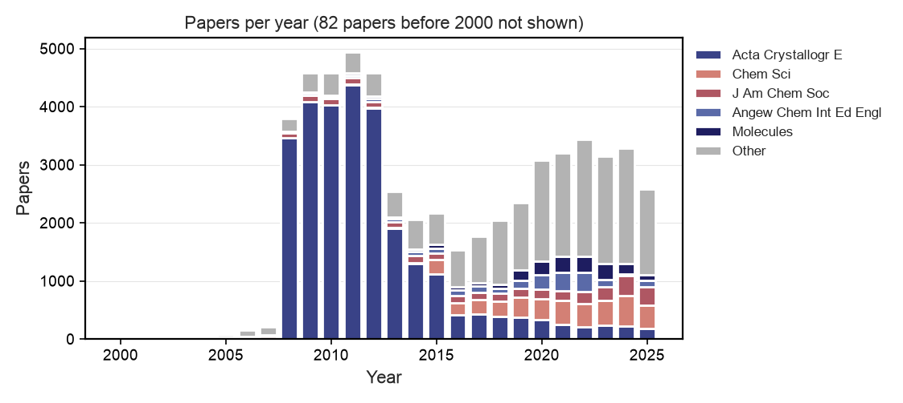
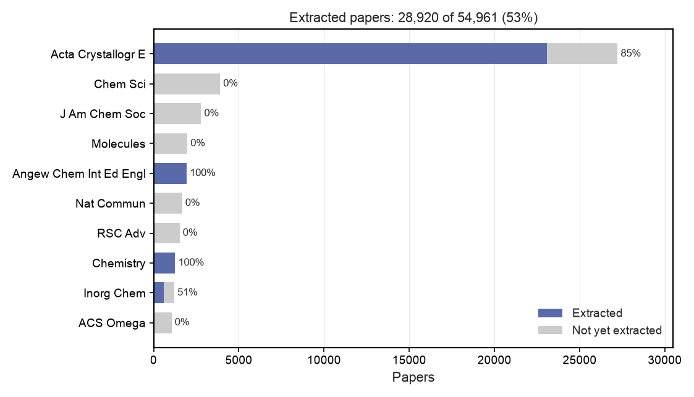
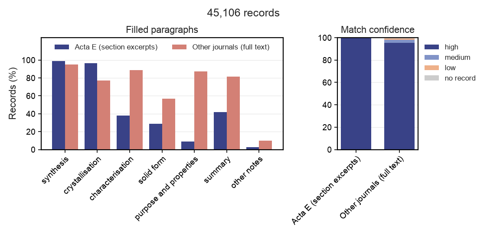
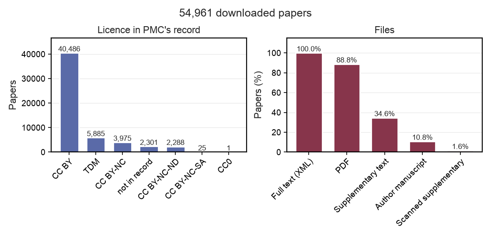

<div align="center">

# TEXtal

**A dataset of crystal structures paired with text-mined crystallization procedures and outcomes.**


</div>

TEXtal links entries in the Cambridge Structural Database (CSD) to the crystallization
procedures and outcomes reported in their papers. We download the open-access papers of the CSD
from PubMed Central (PMC) and, for Acta Crystallographica Section E (Acta E), the journal with
the most CSD entries, every open-access paper the publisher lists. We convert the papers to
Markdown and use a large language model (LLM) to describe how each entry's compound was made and
its crystals were grown. Each record includes quotes from the paper as evidence. The pairs
support two tasks: text-conditioned crystal structure prediction (CSP), which predicts the
crystal that a molecule forms under a written procedure, and condition generation, which
predicts a procedure that yields a given crystal.

**The extraction is not finished.** The hackathon ended before the model had read every paper:
the records cover 28,960 of the 55,001 papers (53%), including 85% of the Acta E papers and
four other journals in full. The rest of the corpus is downloaded and converted, and the
extraction resumes where it stopped. Every statistic below says which part of the corpus it
describes.

---

## Installation

We use the [pixi](https://pixi.sh) dependency manager (Linux only).

```bash
git clone https://github.com/alstonlo/clari-data-osi-hack.git
cd clari-data-osi-hack
pixi install
```

MinerU, the optical character recognition (OCR) tool for scanned PDFs, requires a GPU.
Install it in its own environment:

```bash
pixi install -e ocr
```

## Usage

### CSD Download

The pipeline starts from `data/raw/csd_metadata.full.parquet`, which holds the metadata of every
CSD entry, such as its refcode (entry identifier), compound name, journal and digital object
identifier (DOI). Exporting this metadata requires a licence from the Cambridge Crystallographic
Data Centre (CCDC), so it is not in this repository.

To export it, first download and install the CSD data from the [CCDC downloads
page](https://www.ccdc.cam.ac.uk/support-and-resources/csdsdownloads/). Then install the CSD
Python API, which has its own environment because it pins older versions of NumPy, pandas and
SciPy:

```bash
pixi install -e csd
```

Next, write your CCDC licence code to a file named `.env` at the repository root. The second line
is needed only if the CCDC installer did not record the location of the CSD data in
`~/.config/CCDC/CSD.ini`:

```bash
CCDC_LICENSING_CONFIGURATION=la-code;<your-licence-code>
CSD_DATA_DIRECTORY=<folder of the CSD data>
```

Finally, export the metadata:

```bash
pixi run -e csd python scripts/runs/csd/s0_metadata.py
```

### Build the corpus

The corpus has two sources, collected in two different ways.

**The CSD's papers from PMC.** This command looks up the DOI of every CSD entry in PMC's list,
downloads the papers that are there from PMC's open-access bucket, converts them to Markdown and
plots the corpus figures of this README. The download takes several hours and about 200 GB of
disk space. Rerunning an interrupted download resumes it.

```bash
pixi run snakemake -s scripts/Snakefile -j1 all
```

**Acta E from the publisher's side.** Acta E publishes one crystal structure per paper and has
been fully open access since 2008, so we also collected the journal whole, without going through
the CSD's DOI list: we harvested the publisher's list of open-access papers (IUCr's OAI-PMH
service), looked up each paper's PMC identifier in Europe PMC, and downloaded its complete PMC
package, which also holds the original crystallographic information files (CIFs) and chemical
schemes that the first download left out. We then linked each paper to its CSD entries through
the CCDC numbers printed in it. This collection was made on a cluster with the scripts of the
[`acta-e-extraction-and-viewer`](https://github.com/alstonlo/clari-data-osi-hack/tree/acta-e-extraction-and-viewer)
branch (`scripts/iucr_archive/`), which are tied to that machine's paths and are not part of
this branch. Its result is one table, `data/viz/acta-e-papers.jsonl.gz`, with one line per paper
(its identifiers, licence, the paragraphs of its experimental sections and its CSD refcodes);
[`docs/project-organization.md`](docs/project-organization.md) describes it. Of its 27,266
papers, 27,226 are also in the PMC download; the other 40 cite a DOI that the CSD does not
record.

### Extract the procedures

The extraction calls the model through a LiteLLM proxy and requires an API key. It writes
`data/runs/<name>/extractions.parquet`, with one record per CSD entry. Rerunning a stopped run
resumes it.

```bash
export LITELLM_API_KEY=...
pixi run python -m dataset.extraction_stream --sample 200 --run data/runs/pilot200   # a sample
pixi run python -m dataset.extraction_stream --run data/runs/corpus                  # every paper
```

This runner reads the full Markdown of a paper. The Acta E papers were extracted by a second
runner (`acta_e_stream.py`, on the same branch as the collection) that reads only the paper's
experimental sections and makes the model pick its quotes from numbered passages, so that the
quotes are verbatim by construction. [`docs/EXTRACTION_RUNS.md`](docs/EXTRACTION_RUNS.md) lists
the runs. The records of all runs are gathered in `data/extractions.parquet`, which the figures
and the website are built from:

```bash
pixi run snakemake -s scripts/Snakefile -j1 plot_extraction   # Figures 2 and 3
pixi run snakemake -s scripts/Snakefile -j1 example           # the example record above (needs Chrome)
```

### Website

The website shows the records next to their papers: for each entry, the crystal structures of
its paper (drawn from the publisher's CIFs), its chemical scheme, the paper's text and the
extracted record, with the quote behind each paragraph. It covers every CSD entry of the Acta E
collection and of the other extracted journals. To serve it at http://localhost:8000:

```bash
pixi run web --port 8000
```

The website reads only the tables in `src/viz/assets/`, which hold nothing from the CSD but the
refcodes and their DOIs. Building them needs the Acta E collection, the extracted records, the
bibliography of the other journals' papers (fetched from Europe PMC and Crossref) and their
texts; [`docs/website.md`](docs/website.md) explains the inputs and what the website may show.

```bash
pixi run snakemake -s scripts/Snakefile -j1 assets
```

## About TEXtal

The Cambridge Structural Database (CSD) holds 1.4 million crystal structures, but it does not
systematically record how the crystals were grown; those procedures are described in the papers.
TEXtal is an open pipeline that downloads the 55,001 open-access CSD papers that are in PubMed
Central (PMC), 27,266 of them from Acta E, converts them to Markdown, and uses a large language
model (LLM) to write a record for each CSD entry: how the compound was made and how its crystals
were grown, backed by quotes from the paper. These records can train models for text-conditioned
crystal structure prediction (CSP) and for condition generation.

Because of the time limit of the hackathon, the extraction covers about half of the corpus:
**45,106 CSD entries from 28,960 papers**, extracted in about six hours. The model found the
compound for 99.5% of the entries and rated 97.9% of its matches high confidence; 87% of the
records describe how the crystals were grown.

### Why

CSP models such as [Clari](https://github.com/the-matter-lab/clari) predict how a molecule packs
into a crystal from the molecule alone. But the same molecule can form different crystals
(polymorphs, solvates or salts) depending on how it is crystallized, and these models can neither
take the crystallization procedure as input nor say which solvent, method and temperature produce
a given crystal. Two tasks address this: in text-conditioned CSP, a model predicts the crystal
from the molecule and a written procedure; in condition generation, it predicts the procedure
from the target crystal. Both need crystallization procedures linked to crystal structures. The
CSD has a `solvent` field, but it holds a single string with no method, temperature or time, and
it is empty for 84% of entries. We found no public dataset that links small-molecule
crystallization procedures to CSD entries.

### Approach

1. **Find the papers.** The CSD entries cite 554,956 unique DOIs. Of these, 56,225 are in PMC's
   DOI list, covering 121,147 CSD entries. Most publisher sites block automated downloads,
   but PMC's open-access storage bucket on Amazon Web Services (AWS) allows them. For Acta E, we
   started from the publisher's own list of open-access papers instead, which also finds the
   papers whose DOI the CSD does not record (40), and lets us keep the original CIFs and
   chemical schemes.
2. **Download.** The bucket contained 54,961 of the CSD's papers (203 GB); the Acta E collection
   adds 40, for 55,001 papers. Every paper has its full text as XML; 89% also have a PDF and 35%
   have supplementary documents. We check every file against PMC's checksum.
3. **Convert to Markdown.** Because the main text comes as XML, it needs no optical character
   recognition (OCR); we convert it with pandoc. We convert supplementary PDFs with PyMuPDF4LLM,
   which reads their embedded text. Scanned supplementary PDFs, present in 1.6% of papers,
   require OCR with MinerU, which we have not run yet.
4. **Extract.** We send one LLM request per paper, with the paper's text and a table of its
   CSD entries, including refcode, CCDC number, name and formula. For each entry, the model
   names the compound in the paper and rates its confidence in that match as high, medium or
   low. It then writes one short paragraph per topic: synthesis; crystallization;
   characterization; solid form (such as a salt or hydrate); and purpose and properties. Every
   filled paragraph requires at least one verbatim quote. We ask for paragraphs instead of fixed
   fields (such as solvent, method and temperature) because we do not know in advance what the
   papers report; the fixed fields can be derived from the paragraphs later. The papers of the
   other journals were read in full by `gpt-6-luna`; the Acta E papers, which report one
   structure each in a fixed layout, were read by `gpt-5.6-luna` from their experimental
   sections only (gpt-6-luna's quota was used up by the first run). Both ran at reasoning effort
   `high`.
5. **Show.** A website shows, for each extracted entry, the crystal structures and chemical
   scheme of its paper, the paper's text and the extracted record with its quotes.

<div align="center"><figure>

<figcaption>
<strong>Figure 1.</strong> The 55,001 papers of the corpus by publication year, with colors
indicating journals. Acta E, a journal that publishes one structure per paper, supplies half of
the corpus and nearly all of it before 2013; since 2015, most papers come from general chemistry
journals.
</figcaption>
</figure></div>

### Results

- **The corpus.** The corpus has 55,001 papers and 23,215 supplementary documents in Markdown
  (3.5 GB). Of the papers, 74% are under Creative Commons Attribution (CC BY), so their text can
  be shared. Two thirds of the papers report a single CSD entry, which makes the match between
  paper and entry easy.
- **Extraction, incomplete.** We extracted 45,106 CSD entries from 28,960 papers, 53% of the
  corpus (Figure 2): 23,460 entries from 23,117 Acta E papers (85% of Acta E), and 21,646
  entries from 5,843 papers in other journals (21% of them; Angewandte Chemie, Chemistry: A
  European Journal and Crystal Growth & Design in full, Inorganic Chemistry half-way). The model
  wrote a record for 44,866 entries (99.5%); for 212 it could not find the compound in the paper,
  27 requests failed and 1 paper was missing. It rated 43,973 matches high confidence, 695
  medium and 245 low.
- **The records.** Of the 44,866 records, 97% describe the synthesis, 87% the crystallization,
  62% the characterization, 46% the purpose and properties and 42% the solid form (Figure 3).
  The two runs differ: read from the experimental sections only, the Acta E records nearly
  always have the synthesis and crystallization (99% and 97%) and rarely the rest; read from the
  full text, the other journals' records have more characterization and purpose (89% and 87%)
  but less crystallization (77%), because those papers do not always say how the measured
  crystals were grown. Of the 39,122 entries with a crystallization paragraph, 27,798 (71%) have
  an empty `solvent` field in the CSD.
- **Manual check of 10 papers.** The model matched all 23 CSD entries to the right compound:
  18 through the CCDC number printed next to the compound's label (such as "3a"), 5 through the
  paper's description. Of the 337 quotes, 27 differed from the paper, mostly in hyphenation or
  letter case; one had a changed word. The Acta E runner avoids this by making the model pick
  numbered passages instead of writing the quotes out.
- **Reasoning effort.** At reasoning effort `high` (a setting for how long the model reasons
  before answering), the model gave the same matches and core paragraphs as at `max` and ran
  about 10 times faster, so we use `high`.

<div align="center"><figure>

<figcaption>
<strong>Figure 2.</strong> The papers of the ten largest journals, split into those the model has
read (blue) and those still waiting (grey), with the share read. The extraction ran journal by
journal and stopped at the end of the hackathon, in the middle of Inorganic Chemistry.
</figcaption>
</figure></div>

<div align="center"><figure>

<figcaption>
<strong>Figure 3.</strong> The records of the two runs. Left, the share of records with each
paragraph filled; right, the confidence of the match between the CSD entry and the compound in
the paper. The Acta E run read only the experimental sections, so its records rarely cover
characterization, purpose or the solid form.
</figcaption>
</figure></div>

<div align="center"><figure>

<figcaption>
<strong>Figure 4.</strong> Downloaded papers by licence in the PMC record (left, counts) and file
availability (right, percentages). Most papers are under CC BY. "TDM" (text and data mining)
marks author manuscripts, which PMC lets others reuse; they usually have no PDF.
</figcaption>
</figure></div>

### Next steps

- Finish the extraction: the remaining 26,041 papers (47% of the corpus, mostly general
  chemistry journals), the 4,149 Acta E papers the second run had not reached, and the 27 failed
  requests.
- Check every quote of the full-text run against the source text automatically, and flag records
  whose quotes do not match.
- Derive fixed fields (method, solvents, temperature, time) from the paragraphs, and compare the
  solvents with the CSD `solvent` field where it is filled.
- Run OCR on the scanned supplementary PDFs, and ask publishers for the open-access papers that
  are not in PMC (e.g., Z. Kristallogr. NCS and early IUCrData, about 10,000 papers).
- Release the records of the CC BY papers as a public dataset.

## Licence

The CSD metadata is licensed by the CCDC and is not redistributed here, nor are tables built from
it (the website's tables hold only refcodes and DOIs; `stats.json` holds counts only). Each paper
keeps the licence given in its PMC record, and the Acta E files (CIFs and chemical schemes) the
[terms of use](https://journals.iucr.org/services/termsofuse.html) of the IUCr; the website shows
the text of the CC BY papers only.
